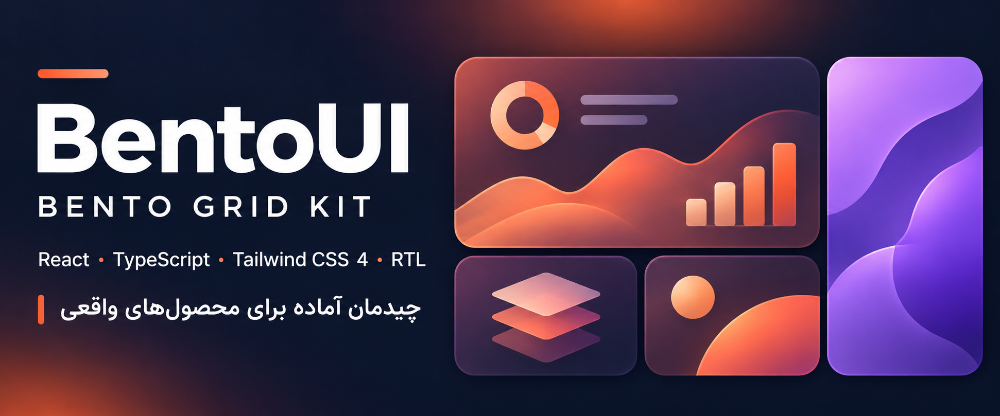

<div align="center">



# BentoUI

### Build expressive product grids without starting from zero.

**React · TypeScript · Tailwind CSS 4 · Responsive · RTL/LTR**

[English](#english) · [فارسی](#فارسی) · [Get started](#quick-start) · [Preview locally](#preview)

</div>

---

<a id="english"></a>

## BentoUI — A Bento Grid kit for real product interfaces

BentoUI is a set of reusable Bento Grid compositions and React cards for showcasing products, projects, articles, and ideas. It gives you a polished starting point for landing pages, portfolios, and dashboards, with responsive layouts and right-to-left support built in.

### What you get

- **Three compositions:** Showcase, Editorial, and Mixed.
- **Flexible Showcase grid:** Choose a three- or four-column desktop layout.
- **Responsive behavior:** Cards adapt from a mobile stack to tablet and desktop grids.
- **RTL and LTR support:** Direction-aware layouts for Persian, Arabic, Hebrew, and English.
- **Light and dark themes:** Preview and adapt both themes.
- **Reusable React + TypeScript components:** Pass content and links through typed props, or compose the cards in your own grid.
- **Local assets:** Included illustrations and icons work without external image requests.

### Preview

Run the preview locally and use the controls to switch layout, direction, column count, and theme. A hosted public demo is not available yet.

### Quick start

```bash
git clone https://github.com/flowsee-org/bentoui.git
cd bentoui
npm install
npm run dev
```

### Use a section

```tsx
import { BentoSection } from './src/components/Bento'

export function WorkSection() {
  return <BentoSection pattern="showcase" columns={3} />
}
```

Choose `showcase`, `editorial`, or `mixed` with the `pattern` prop. Set `columns={4}` for a four-column Showcase. Pass `items`, `title`, and `allHref` to customize the section, or compose `ProjectCard` and `ArticleCard` directly.

### Components

`BentoSection`, `HeroBentoCard`, `ProjectCard`, `ArticleCard`, `BentoCover`, and `BentoArrow` are exported from `src/components/Bento.tsx`. The same file exports the `Pattern`, `StoryKey`, and `Story` TypeScript types.

### Development commands

```bash
npm run dev      # Start the local preview
npm run build    # Type-check and build for production
npm run preview  # Preview the production build
npm run lint     # Run Oxlint
```

Requires Node.js 20.19+ or 22.12+ and npm. The project uses React 19, TypeScript 7, Vite 8, and Tailwind CSS 4.

### Responsive layout

- Under 768px: one-column stack.
- From 768px: two-column tablet composition.
- From 1024px: full desktop Bento placement.

The section is capped at 1200px, with 24px grid gaps and a 360px minimum row height. Set `dir="rtl"` or `dir="ltr"` on a parent to control direction. Add the `dark` class to a parent to activate the dark palette.

### Project structure

```text
src/components/Bento.tsx  Reusable cards and section component
src/data.ts               Example content and grid placement
src/index.css             Tailwind import, theme tokens, font setup
src/App.tsx                Interactive layout preview
public/bento/              Illustrations and icons
public/preview/             Repository banner
```

### Notes

- The Dana typeface is commercial and is not included. Add a licensed WOFF2 file to your project and configure `src/index.css` if you use that font.
- Example destinations such as `/work` and `/blog` need to be connected to your app router or CMS.
- A hosted public demo is not available yet. Add its URL here after deployment.
- No license has been added yet. Add a `LICENSE` file before redistributing the kit.

---

<a id="فارسی"></a>

## BentoUI — کیت طراحی Bento Grid برای رابط‌های واقعی

BentoUI مجموعه‌ای از چیدمان‌های آماده و کارت‌های قابل‌استفادهٔ مجدد برای نمایش محصول، پروژه، مقاله و ایده است. با آن می‌توانی برای صفحهٔ معرفی محصول، پورتفولیو یا داشبورد، سریع‌تر به یک چیدمان منسجم و واکنش‌گرا برسی؛ پشتیبانی از رابط راست‌چین هم از ابتدا در نظر گرفته شده است.

### داخل کیت چه چیزهایی هست؟

- **سه ترکیب آماده:** Showcase، Editorial و Mixed.
- **چیدمان منعطف Showcase:** انتخاب نسخهٔ سه‌ستونه یا چهارستونه در دسکتاپ.
- **نمایش واکنش‌گرا:** چیدمان کارت‌ها از موبایل تا تبلت و دسکتاپ تغییر می‌کند.
- **پشتیبانی RTL و LTR:** مناسب فارسی، عربی، عبری و انگلیسی.
- **تم روشن و تیره:** هر دو حالت را در پیش‌نمایش ببین و با محصولت هماهنگ کن.
- **کامپوننت‌های React و TypeScript:** محتوا و لینک‌ها را با پراپ‌های تایپ‌شده تنظیم کن یا کارت‌ها را در گرید دلخواهت بچین.
- **تصویرها و آیکن‌های محلی:** برای نمایش نمونه‌ها به درخواست تصویر خارجی نیاز نیست.

### شروع سریع

```bash
git clone https://github.com/flowsee-org/bentoui.git
cd bentoui
npm install
npm run dev
```

### استفاده در پروژه

```tsx
import { BentoSection } from './src/components/Bento'

export function WorkSection() {
  return <BentoSection pattern="showcase" columns={3} />
}
```

با پراپ `pattern` یکی از ترکیب‌های `showcase`، `editorial` یا `mixed` را انتخاب کن. برای Showcase چهارستونه، `columns={4}` بگذار. با `items`، `title` و `allHref` محتوا و لینک بخش را عوض کن؛ برای ترکیب اختصاصی هم می‌توانی کارت‌های `ProjectCard` و `ArticleCard` را مستقیم استفاده کنی.

### اجزای قابل استفاده

از فایل `src/components/Bento.tsx` می‌توانی این کامپوننت‌ها را وارد کنی: `BentoSection`، `HeroBentoCard`، `ProjectCard`، `ArticleCard`، `BentoCover` و `BentoArrow`. نوع‌های `Pattern`، `StoryKey` و `Story` هم در همان فایل قرار دارند.

### تغییر اندازه و جهت

- کمتر از 768 پیکسل: یک ستون.
- از 768 پیکسل: ترکیب دو ستونهٔ تبلت.
- از 1024 پیکسل: چیدمان کامل Bento در دسکتاپ.

عرض بخش حداکثر 1200 پیکسل است، فاصلهٔ بین کارت‌ها 24 پیکسل و حداقل ارتفاع ردیف‌ها 360 پیکسل است. برای راست‌چین یا چپ‌چین کردن، روی والد `dir="rtl"` یا `dir="ltr"` بگذار. کلاس `dark` روی والد، رنگ‌های تم تیره را فعال می‌کند.

### نکته‌ها

- فونت Dana تجاری است و همراه پروژه منتشر نشده. اگر مجوزش را داری، فایل WOFF2 را به پروژه اضافه و در `src/index.css` تنظیم کن.
- لینک‌هایی مانند `/work` و `/blog` نمونه‌اند و باید به مسیرهای روتر یا CMS پروژه وصل شوند.
- لینک پیش‌نمایش بالای صفحه آدرس محلی توسعه است. پس از انتشار دمو، آن را با لینک عمومی جایگزین کن.
- هنوز مجوز استفاده به پروژه اضافه نشده؛ پیش از بازنشر، فایل `LICENSE` انتخاب و اضافه کن.

---

## Share BentoUI

### X / Twitter — English

```text
Meet BentoUI: a responsive Bento Grid kit for React, TypeScript & Tailwind CSS 4.

3 layouts. Dark mode. RTL/LTR support. Reusable cards, ready to shape around your product.

Explore the kit → https://github.com/flowsee-org/bentoui
#React #TailwindCSS #OpenSource #UIDesign
```

### X / Twitter — فارسی

```text
BentoUI رو ببین؛ یک کیت Bento Grid برای React، TypeScript و Tailwind CSS 4.

سه ترکیب آماده، تم روشن و تیره، پشتیبانی راست‌چین و کارت‌های قابل‌استفادهٔ مجدد برای محصول واقعی.

مشاهده در گیت‌هاب: https://github.com/flowsee-org/bentoui
#React #TailwindCSS #طراحی_رابط
```
